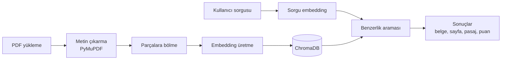

# PDF Belgelerinde Anlamsal Arama Yapabilen Doküman Yönetim Sistemi

Fırat Üniversitesi Bilgisayar Mühendisliği Tasarım dersi kapsamında geliştirilen takım projesi — kısaca, **Ctrl+F'in anlamsal hali**.

> **Durum:** Anlamsal arama modülünün (embedding, vektör indeksleme, arama API'si, PDF görüntüleyici arayüz ve Android istemcisi) ilk çalışan prototipi tamamlandı. Bu depo, ekibin daha önce planladığı mimariyle uyumlu; aşağıdaki bölümler artık gerçek kurulum/kullanım adımlarını yansıtıyor.

## Proje Hakkında

Klasik arama yöntemleri yalnızca sorgudaki kelimelerin belgede birebir geçip geçmediğine bakar. Kullanıcı aradığı bilgiyi farklı kelimelerle, eş anlamlı ya da farklı çekimlenmiş sözcüklerle ifade ettiğinde ilgili sonuçlar gözden kaçar. Türkçe gibi eklemeli dillerde bu sorun daha da belirgindir.

Bu proje, PDF belgelerinin yüklenip yönetilebildiği ve bu belgelerde **anlama dayalı arama** yapılabilen bir sistem geliştirmeyi amaçlar. Kullanıcı sorusunu doğal bir cümleyle yazar, sistem anlamca en ilgili pasajları belge adı, sayfa numarası ve benzerlik puanıyla birlikte listeler.

## Hedefler

- PDF dosyalarından sayfa bilgisi korunarak metin çıkarma, taranmış sayfalar için OCR desteği
- [x] Türkçeyi destekleyen bir embedding modeliyle anlamsal arama — ayrıca çapraz dil (cross-lingual) çalışır: doküman İngilizce, sorgu Türkçe olabilir, veya tam tersi
- Test kümesinde doğru pasajın ilk 5 sonuç içinde yer alma oranının (Recall@5) en az %80 olması
- İndekslenmiş yaklaşık 1000 sayfalık koleksiyonda sorgu yanıt süresinin ortalama 1 saniyenin altında olması
- Belge listeleme, etiketleme, silme ve yeniden indeksleme
- [x] Sonuçların pasaj vurgulanarak gösterildiği web arayüzü

## Nasıl Çalışıyor



1. **Metin çıkarma:** Yüklenen PDF'lerden metin sayfa sayfa çıkarılır (PyMuPDF). Taranmış sayfalar için OCR desteği henüz eklenmedi.
2. **Parçalara bölme:** Metin, birbiriyle kısmen örtüşen küçük parçalara ayrılır. Her parça belge ve sayfa bilgisiyle saklanır.
3. **Embedding:** Her parça, çok dilli bir `sentence-transformers` modeliyle anlamını temsil eden bir vektöre dönüştürülür.
4. **İndeksleme:** Vektörler ChromaDB'ye kaydedilir.
5. **Arama:** Sorgu da vektöre çevrilir ve kosinüs benzerliğiyle en yakın parçalar bulunur. Anahtar kelime (BM25) ile hibrit arama henüz eklenmedi.
6. **Arayüz:** En alakalı sonuca tıklandığında PDF o sayfaya gider ve eşleşen metin vurgulanır (pdf.js).

## Kullanılan Teknolojiler

| Katman | Teknoloji |
|---|---|
| Arka uç | Python, FastAPI |
| PDF işleme | PyMuPDF |
| Embedding | sentence-transformers (`paraphrase-multilingual-MiniLM-L12-v2`) — yerel/ücretsiz, API key gerekmez |
| Vektör veritabanı | ChromaDB |
| İlişkisel veritabanı | SQLite (doküman metadata) |
| Ön yüz | Tek sayfalık HTML/JS + pdf.js (ilk prototip; React'e geçiş ekip kararına açık) |
| Mobil | Flutter (WebView ile aynı arayüzü Android'de açan ince istemci) |

## Ekip

| Adı Soyadı | Görevi |
|---|---|
| Gurbet Fidan | Backend geliştirme: PDF işleme modülü ve arama API'si |
| Onur Can Sarı | Anlamsal arama: embedding modeli, vektör indeksleme ve performans testleri |
| Elif Gül Söylemez | Ön yüz geliştirme: kullanıcı arayüzü, belge yönetimi ekranları ve test kümesi |

## İlerleme

- [x] Problem tanımı ve literatür taraması
- [x] Sistem mimarisi ve teknoloji seçimi
- [x] İş paketleri ve görev dağılımı
- [ ] PDF işleme modülü (OCR dahil)
- [x] Embedding ve vektör indeksleme
- [x] Arama servisi ve API (ilk prototip)
- [x] Kullanıcı arayüzü (ilk prototip)
- [ ] Test ve performans değerlendirmesi (Recall@5 benchmarkı henüz yapılmadı; istek bazlı performans ölçüldü, bkz. Performans)

## Performans

Embedding modeli ve ChromaDB bağlantısı process içinde tek sefer kurulup
tüm isteklerde paylaşılır, ve sunucu açılışında önceden ısıtılır. Bunu
yapmasaydık, sunucu her yeniden başladığında ilk isteği atan kullanıcı
modelin belleğe yüklenmesini (~saniyeler) beklemek zorunda kalırdı — bu
ölçülüp doğrulandı (ilk istek 18s → 150ms). Model diskte cache'liyse
HuggingFace Hub'a "güncel mi" diye sormadan (offline) yüklenir, bu da
gereksiz bir ağ çağrısını ortadan kaldırır.

## Kurulum

### 1. Gereksinimler
- Python 3.10+

### 2. Projeyi kur
```bash
python -m venv venv
venv\Scripts\activate
pip install -r requirements.txt
```

İlk çalıştırmada çok dilli `sentence-transformers` embedding modelini
(~420MB) bir kere indirir, sonrasında internet gerekmez.

### 3. Çalıştır
```bash
python -m uvicorn main:app --reload
```

Tarayıcıda aç: http://127.0.0.1:8000

### 4. API dokümantasyonu
```
http://127.0.0.1:8000/docs
```

## Testleri çalıştır
```bash
python -m pytest tests/ -v
```

## Proje yapısı
```
pdf-semantic-search/
├── src/
│   ├── domain/          # Document entity, repository interface
│   ├── infrastructure/  # SQLAlchemy ORM, repository implementasyonu
│   ├── application/     # SearchService (yukleme + arama is mantigi)
│   ├── api/             # FastAPI route'lari
│   └── rag/             # PDF okuma, chunking, ChromaDB vektor arama
├── tests/               # Unit testler
├── uploads/             # Yuklenen PDF'ler (git'e girmez)
├── ui.html              # Tek sayfalik arayuz (pdf.js ile PDF goruntuleme + vurgulama)
├── mobile/              # Android istemcisi (Flutter, ui.html'i WebView'de acar)
└── main.py              # Uygulama giris noktasi
```

## Android uygulaması
`mobile/` klasöründe, bu aynı arayüzü bir Android WebView içinde açan küçük
bir Flutter istemcisi var. Kurulum ve çalıştırma adımları için
[mobile/README.md](mobile/README.md)'ye bak.

## API özeti
| Method | Endpoint | Açıklama |
|---|---|---|
| POST | `/api/documents/upload` | PDF yükle ve indeksle |
| GET | `/api/documents/` | Yüklenen dokümanları listele |
| GET | `/api/documents/{id}` | Doküman detayı |
| GET | `/api/documents/{id}/file` | Ham PDF dosyası (görüntüleyici için) |
| POST | `/api/documents/{id}/search` | Doküman içinde anlamsal arama |
| DELETE | `/api/documents/{id}` | Dokümanı ve vektörlerini sil |

## Temel Kaynaklar

- Reimers, N., & Gurevych, I. (2019). [Sentence-BERT: Sentence Embeddings using Siamese BERT-Networks](https://aclanthology.org/D19-1410.pdf). EMNLP-IJCNLP 2019.
- Reimers, N., & Gurevych, I. (2020). [Making Monolingual Sentence Embeddings Multilingual using Knowledge Distillation](https://aclanthology.org/2020.emnlp-main.365.pdf). EMNLP 2020.
- Karpukhin, V. ve diğerleri (2020). [Dense Passage Retrieval for Open-Domain Question Answering](https://aclanthology.org/2020.emnlp-main.550.pdf). EMNLP 2020.
- Thakur, N. ve diğerleri (2021). [BEIR: A Heterogenous Benchmark for Zero-shot Evaluation of Information Retrieval Models](https://arxiv.org/pdf/2104.08663). NeurIPS 2021.

Kaynakların tam listesi proje raporunda yer almaktadır.
